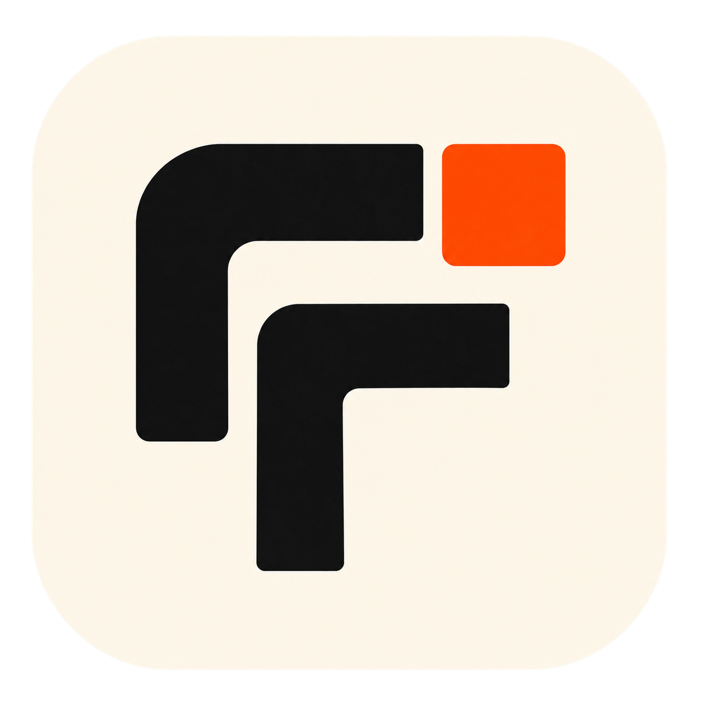
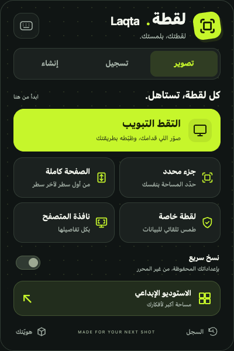
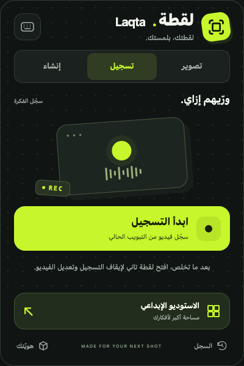
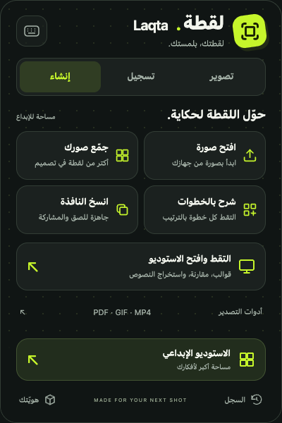

<div align="center">
  

  <h1>لقطة — Laqta</h1>

  <p><strong>Capture. Polish. Explain.</strong></p>
  <p>A Chrome extension for screenshots, tab recordings, visual tutorials, and local text recognition.</p>

  <p>
    
    
    
  </p>

  <p><a href="#install">Install</a> · <a href="#creative-studio">Creative Studio</a> · <a href="#privacy-and-network-access">Privacy</a> · <a href="#بالعربي">بالعربي</a></p>
</div>

---

Laqta brings screenshot capture, editing, and presentation into one extension. Capture a page, give it a frame, hide sensitive details, or turn a sequence of screenshots into a numbered guide.

This repository contains an unpacked extension, including its compiled editor and a separate Creative Studio. **No build step or API key is required to load it.**

## A new look for your next shot

An Arabic RTL popup with a dark dotted canvas, lime accents, and dedicated
**تصوير** (Capture), **تسجيل** (Record), and **إنشاء** (Create) tabs. Common
actions fit within the 400×600 popup; Studio, history, and branding stay within reach.

| Capture | Record | Create |
| :---: | :---: | :---: |
|  |  |  |

## Features

| Area | What you can do |
| --- | --- |
| Screenshots | Capture the visible tab, a selected area, the Chrome window, or a full scrolling page. |
| Editing | Add frames, backgrounds, annotations, redactions, and mockup treatments. |
| Private capture | Automatically blur detected emails, phone numbers, and secrets. Review the result before sharing. |
| Recording | Record the active tab and use the included video editing/export flow. |
| Collages & guides | Combine images or capture a sequence of steps. Studio adds numbered captions and adjustable arrows. |
| Before & After | Compare two images side by side or with a reveal slider. |
| OCR | Extract English, Arabic, or mixed text from an image; edit and copy the result. |
| Branding | Apply a saved text watermark or logo with position, size, and opacity controls. |
| Export | Studio exports PNG, JPEG, or WebP with width and quality controls. Additional tools offer PDF printing, animated GIF, and browser-dependent MP4 conversion. |
| History | Browse captures saved by the extension's existing history flow. |

## Install

1. Download this repository using **Code → Download ZIP**, then extract it; or clone it:

   ```bash
   git clone https://github.com/yousefdiab611/Laqta.git
   ```

2. Open `chrome://extensions` in Chrome.
3. Enable **Developer mode**.
4. Click **Load unpacked** and select the folder containing `manifest.json`.
5. Pin **لقطة — Laqta** from Chrome's extensions menu.

After updating the files, click **Reload** on the extension card. Reopen existing extension tabs to load the updated UI.

> This is a manual, unpacked installation. The repository does not provide a Chrome Web Store release.

## Quick start

**For a styled screenshot**

Open a website, click Laqta, and choose **التقط التبويب**, **جزء محدد**, or **الصفحة كاملة**. Edit the capture, then download or copy it.

**For templates, tutorials, comparisons, or OCR**

Choose **التقط وافتح الاستوديو** in the **إنشاء** tab to send the current visible tab directly to Studio. You can also open **الاستوديو الإبداعي** from the footer and upload images, or choose **Open in Creative Studio** from the editor.

### Keyboard shortcuts

| Action | Windows / Linux | macOS |
| --- | --- | --- |
| Capture visible tab | `Ctrl + Shift + S` | `Command + Shift + S` |
| Select an area | `Ctrl + Shift + E` | `Command + Shift + E` |

Manage shortcuts at `chrome://extensions/shortcuts`. Recording, full-page capture, and capture-session actions also have assignable commands.

## Creative Studio

### Templates

Choose **Studio / Ivory**, **Social / Coral square**, **Product / Midnight**, or **Presentation / Blue widescreen**. Add an optional title and preview the result.

The square and widescreen aspect ratios apply to the **Framed screenshot** layout. Tutorial and comparison layouts use dimensions suited to their content.

### Numbered tutorials

1. Upload your screenshots.
2. Select **Numbered tutorial**.
3. Add a caption to each image and reorder the steps.
4. Enable an arrow where needed and adjust its target using the X/Y controls.
5. Export the complete guide as an image.

### Before & After

The first two images become the comparison pair. Choose **Side by side** or **Interactive slider**, then adjust the reveal position.

**Exports are static images** showing the current reveal position; the exported file does not contain an interactive slider.

### Arabic & English OCR

Select an image, choose **English**, **Arabic**, or **English + Arabic**, and click **Extract text**. Review the editable output and copy it.

OCR runs on the selected **original image**, not the composed template. Its worker, WebAssembly engine, and language models are bundled with the extension, so recognition can run offline. No OCR API key is needed.

### Brand Kit

Open **هويّتك** in the popup footer to reach Brand Kit, enable it, set a text watermark or upload a logo, choose the position and opacity, and save.

This personalized version initializes the watermark to:

**Yousef Diab | Dokkan Agency**

The initial setup runs once; later changes and disabling the watermark are preserved. A configured logo takes precedence over the text fallback. Studio's **Apply saved Brand Kit** checkbox controls whether branding is included in that export.

Studio export settings apply to **Studio exports**. The compiled editor keeps its existing export behavior.

### Output limits

- Up to **12 images** in one Studio composition.
- Individual uploads: at most **40 megapixels**.
- Export width: **320–4096 pixels**.
- Composition: at most **32 megapixels** and **16,000 pixels** high.
- PNG is lossless; the quality slider applies to JPEG and WebP.
- Studio images are held in the tab and are lost when it closes or reloads.

## Privacy and network access

Screenshot composition and Studio OCR process images locally. Capture transfers temporarily use extension local storage and are removed when imported into Studio. Brand Kit settings persist in local storage.

**Local image processing does not mean the entire extension has no network activity.** This version is based on FramedShot and retains legacy analytics code, links, and configuration:

- The manifest still includes the `framed-shot.com` host permission, homepage, and Chrome update URL.
- Analytics code references `https://framed-shot.com/api/analytics`. It uses the presence of `update_url` to choose its default transport. Because this manifest includes that field, the legacy endpoint is selected by default even when these files are loaded unpacked.
- The compiled editor retains upstream support, rating, and feature-request flows.

The popup's **Supporter Badge** email signup has been removed. No blanket claim of a fully offline extension or zero telemetry is made for this repository.

### Permissions

| Permission | Purpose |
| --- | --- |
| `activeTab` | Access the active tab after a user action. |
| `scripting` | Run selection and page-capture helpers. |
| `storage` | Save preferences and support capture handoffs. |
| `tabCapture` | Record tab media. |
| `desktopCapture` | Capture a selected browser window/screen source. |
| `offscreen` | Run recording work outside the popup. |
| `clipboardWrite` (optional) | Support copying output to the clipboard. |
| `https://framed-shot.com/*` | Retained upstream service access. |

## Project layout

```text
manifest.json          Chrome Manifest V3 configuration
popup/                 Capture actions and Studio entry points
editor/                Compiled editor assets and Studio transfer button
studio/                Templates, tutorials, comparisons, OCR, and image export
  vendor/              Bundled Tesseract runtime, models, and licenses
brand-kit/             Watermark preferences and preview
export-tools/          PDF, GIF, and MP4 tools
history/               Capture history UI
screen-capture/        Window capture UI
src/background/        Capture, recording, branding, and analytics services
src/lib/               Shared storage helpers and personal branding setup
src/offscreen/         Offscreen recording document
welcome/               Installation guide
```

## Development and verification

Edit the unpacked files and reload the extension. The editor is provided as a **compiled bundle**; its original application source and build configuration are not included. Studio uses plain JavaScript, HTML, and CSS.

The current Studio implementation was checked in Chromium with Playwright for bilingual OCR, offline recognition, templates, numbered captions, arrow controls, comparison layouts, JPEG/WebP downloads, watermark behavior, editor-to-Studio transfer, invalid-size handling, and a 390px layout without horizontal overflow. These are recorded manual verification results, not a committed automated test suite.

The redesigned popup was checked for RTL keyboard tab navigation, Quick Copy
on/off, session restore/cancel, and all three panels fitting at 400×600. An
injected recording-status fixture verified selecting the recording tab and
showing the stop button/timer when a recording is restored; this did not start
a real recording. Gallery screenshots use a normal-site URL fixture.

See [Studio documentation](studio/README.md) for implementation notes and limits,
and the [popup layout decision](docs/adr/0001-popup-navigation.md) for UI structure.

## Troubleshooting

- **The name or UI did not change:** reload the extension and reopen its popup/editor tabs.
- **Capture fails on a Chrome system page:** try a normal website. Chrome restricts capture and injected scripts on some internal/protected pages.
- **OCR output is inaccurate:** select the appropriate language, use a sharper screenshot, and review the extracted text.
- **A comparison will not export:** add at least two images.
- **Composition too large:** reduce output width or remove tutorial steps.
- **MP4 conversion is unavailable:** this feature depends on the browser's MediaRecorder support; the tool reports when it is unsupported.

## Credits and licensing

Laqta is a personalized adaptation of **FramedShot**, with added Creative Studio functionality and branding changes. The existing editor is distributed here in compiled form.

OCR uses **Tesseract.js 6.0.1**, **tesseract.js-core 6.0.0**, and English/Arabic trained data. Their provenance and license notices are in [studio/vendor/README.md](studio/vendor/README.md).

No project-wide license is included in this repository. Bundled dependency licenses apply to their respective components.

---

## بالعربي

**لقطة — Laqta** إضافة Chrome لتصوير الصفحات وتعديل الصور وعمل شروحات واستخراج النصوص.

### التثبيت

1. نزّل المستودع ZIP وفك الضغط.
2. افتح `chrome://extensions` وفعّل **Developer mode**.
3. اضغط **Load unpacked** واختار المجلد اللي فيه `manifest.json`.
4. ثبّت أيقونة الإضافة في شريط المتصفح.

### الاستخدام

الواجهة عربية من اليمين لليسار، ومقسّمة لتبويبات **تصوير، تسجيل، وإنشاء**.

- **التقط التبويب / جزء محدد / الصفحة كاملة:** صوّر التاب أو جزء منه أو الصفحة كاملة.
- **إنشاء ← التقط وافتح الاستوديو:** انقل صورة التاب مباشرة للاستوديو.
- **الاستوديو الإبداعي:** قوالب جاهزة، شرح مرقّم، أسهم، مقارنة قبل وبعد، واستخراج نص عربي وإنجليزي.
- **هويّتك (Brand Kit):** غيّر الاسم أو اللوجو ومكان العلامة المائية وشفافيتها.
- **Export:** صدّر PNG أو JPEG أو WebP بالمقاس والجودة المناسبين.

الاسم الافتراضي للعلامة المائية هو **Yousef Diab | Dokkan Agency**، وتقدر تغيّره أو تعطّله. المقارنة بتتصدّر كصورة ثابتة. صور الاستوديو مش بتتحفظ تلقائيًا بعد إغلاق التاب.

معالجة الصور وOCR محلية، لكن النسخة الحالية لسه فيها كود وروابط لخدمات FramedShot؛ راجع قسم الخصوصية فوق للتفاصيل.
